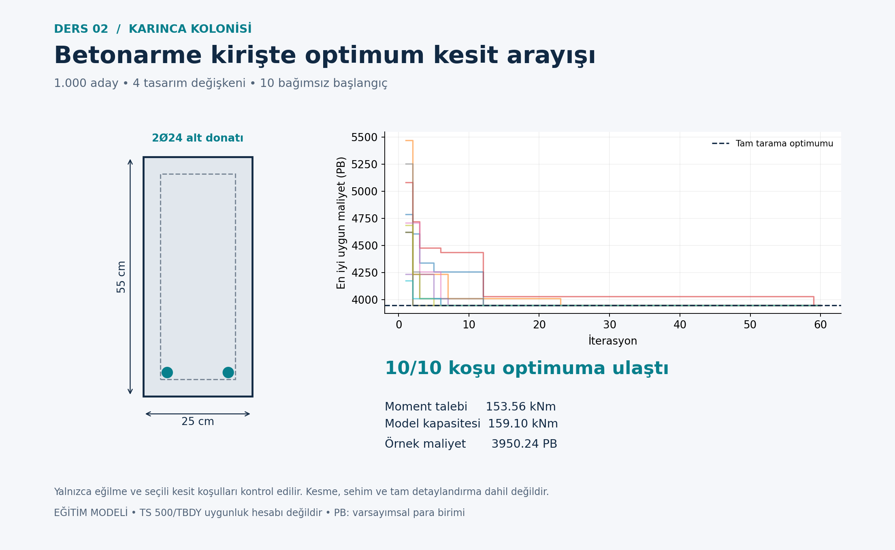

# Ant colony optimization · RC beam

[Collection](../README.md) · [Türkçe](README.tr.md) · [Detailed Turkish model notes](OKU.md)

## Design problem

A 6 m simply supported beam with 30 kN/m external factored load plus model self-weight. 1,000 combinations; flexural capacity, minimum steel, tensile strain and bar spacing checks.

**Variables and objective:** Discrete width, depth, bar count and diameter. Minimize concrete and bottom-steel material cost.

```text
C = 3000 V_c + 35 m_s
```

Concrete/steel examples use hypothetical currency units (PB), not current prices. Internal structural units are documented in [OKU.md](OKU.md). The algorithm implementations are educational variants; read the model notes for operators, constraint handling, random seeds and evaluation budgets.

## Run

From the repository root, with Python 3.11 or later:

```bash
cd 02-ant-colony-beam
python -m pip install -r requirements.txt
python aco_kiris.py
python grafikleri_ciz.py
```

Run within this lesson folder. Python identifiers and detailed teaching notes retain their original Turkish names. Outputs overwrite existing result files. After changing inputs, regenerate plots; explanatory Markdown numbers do not update automatically.

## Verification

```bash
python -m unittest test_hesap.py -v
```

This lesson includes numerical/algorithm unit tests. See [numerical checks](SONUC_KONTROLLERI.md) for the stored reference results.

## Example output



## Scope and references

Single-layer positive flexure only; no shear, deflection, cracking or complete reinforcement detailing. These are educational models, not construction-ready or code-compliant structural designs.

Detailed equations, assumptions, source references, results and exercises are in [OKU.md](OKU.md). Read [provenance](../PROVENANCE.md) and [license status](../LICENSE_STATUS.md).
