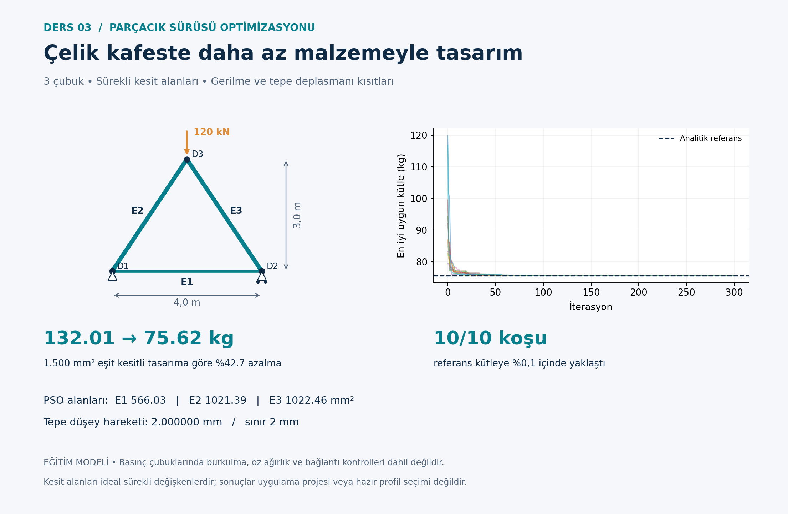

# Particle swarm optimization · Steel truss

[Collection](../README.md) · [Türkçe](README.tr.md) · [Detailed Turkish model notes](OKU.md)

## Design problem

Three-node triangular truss, 4 m span and 3 m height; 120 kN downward apex load. Absolute axial stress ≤160 MPa and apex vertical displacement ≤2 mm.

**Variables and objective:** Three continuous member areas between 200 and 3,000 mm². Minimize total mass.

```text
m = rho sum(A_i L_i)
```

Concrete/steel examples use hypothetical currency units (PB), not current prices. Internal structural units are documented in [OKU.md](OKU.md). The algorithm implementations are educational variants; read the model notes for operators, constraint handling, random seeds and evaluation budgets.

## Run

From the repository root, with Python 3.11 or later:

```bash
cd 03-particle-swarm-truss
python -m pip install -r requirements.txt
python pso_kafes.py
python grafikleri_ciz.py
```

Run within this lesson folder. Python identifiers and detailed teaching notes retain their original Turkish names. Outputs overwrite existing result files. After changing inputs, regenerate plots; explanatory Markdown numbers do not update automatically.

## Verification

```bash
python -m unittest test_hesap.py -v
```

This lesson includes numerical/algorithm unit tests. See [numerical checks](SONUC_KONTROLLERI.md) for the stored reference results.

## Example output



## Scope and references

Linear elastic axial bars; no buckling, out-of-plane stability, self-weight loads or connection design. These are educational models, not construction-ready or code-compliant structural designs.

Detailed equations, assumptions, source references, results and exercises are in [OKU.md](OKU.md). Read [provenance](../PROVENANCE.md) and [license status](../LICENSE_STATUS.md).
