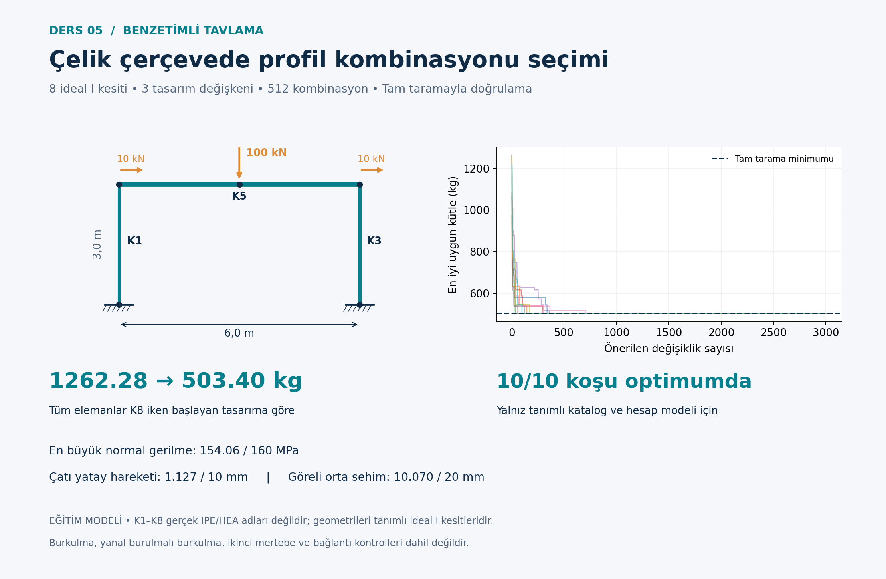

# Simulated annealing · Steel frame

[Collection](../README.md) · [Türkçe](README.tr.md) · [Detailed Turkish model notes](OKU.md)

## Design problem

512 combinations. Linear elastic plane-frame analysis checks elastic normal stress, roof horizontal movement and beam midpoint movement relative to its ends.

**Variables and objective:** Choose left-column, right-column and beam sections from eight synthetic sections. Minimize total mass.

```text
m = rho sum(A_i L_i)
```

Concrete/steel examples use hypothetical currency units (PB), not current prices. Internal structural units are documented in [OKU.md](OKU.md). The algorithm implementations are educational variants; read the model notes for operators, constraint handling, random seeds and evaluation budgets.

## Run

From the repository root, with Python 3.11 or later:

```bash
cd 05-simulated-annealing-frame
python -m pip install -r requirements.txt
python sa_cerceve.py
python grafikleri_ciz.py
```

Run within this lesson folder. Python identifiers and detailed teaching notes retain their original Turkish names. Outputs overwrite existing result files. After changing inputs, regenerate plots; explanatory Markdown numbers do not update automatically.

## Verification

```bash
python -m unittest test_hesap.py -v
```

This lesson includes numerical/algorithm unit tests. See [numerical checks](SONUC_KONTROLLERI.md) for the stored reference results.

## Example output



## Scope and references

No member/frame buckling or full code interaction checks; synthetic sections are not a manufacturer catalog. These are educational models, not construction-ready or code-compliant structural designs.

Detailed equations, assumptions, source references, results and exercises are in [OKU.md](OKU.md). Read [provenance](../PROVENANCE.md) and [license status](../LICENSE_STATUS.md).
