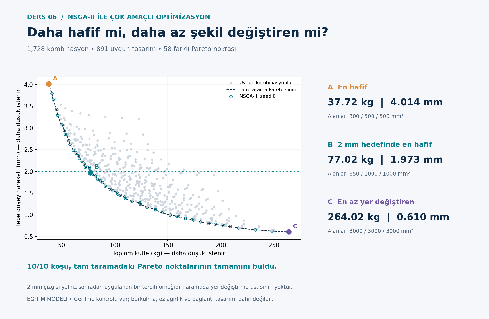

# NSGA-II · Multiobjective steel truss

[Collection](../README.md) · [Türkçe](README.tr.md) · [Detailed Turkish model notes](OKU.md)

## Design problem

Same triangular geometry and 120 kN apex load as lesson 3; stress ≤160 MPa. 1,728 combinations. Displacement is an objective; 2 mm is only a post-processing preference.

**Variables and objective:** Three discrete member areas from a 12-value list. Minimize mass and absolute apex vertical displacement simultaneously.

```text
f1 = rho sum(A_i L_i); f2 = abs(u_y,apex)
```

Concrete/steel examples use hypothetical currency units (PB), not current prices. Internal structural units are documented in [OKU.md](OKU.md). The algorithm implementations are educational variants; read the model notes for operators, constraint handling, random seeds and evaluation budgets.

## Run

From the repository root, with Python 3.11 or later:

```bash
cd 06-nsga2-truss
python -m pip install -r requirements.txt
python nsga2_kafes.py
python grafikleri_ciz.py
```

Run within this lesson folder. Python identifiers and detailed teaching notes retain their original Turkish names. Outputs overwrite existing result files. After changing inputs, regenerate plots; explanatory Markdown numbers do not update automatically.

## Verification

```bash
python -m unittest test_hesap.py -v
```

This lesson includes numerical/algorithm unit tests. See [numerical checks](SONUC_KONTROLLERI.md) for the stored reference results.

## Example output



## Scope and references

No buckling, out-of-plane stability, self-weight loads or connection design. Discrete NSGA-II results cannot directly rank performance against continuous PSO. These are educational models, not construction-ready or code-compliant structural designs.

Detailed equations, assumptions, source references, results and exercises are in [OKU.md](OKU.md). Read [provenance](../PROVENANCE.md) and [license status](../LICENSE_STATUS.md).
