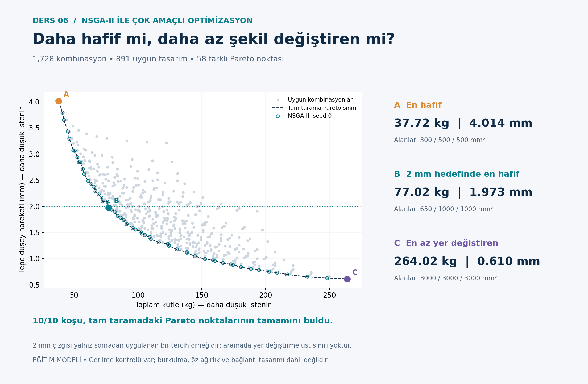

# Structural Optimization with Python

Six reproducible teaching examples exploring metaheuristic optimization in structural design.

**Prepared for Onur Kızılarslan's structural optimization coursework, with AI assistance.**

[**Türkçe açıklama**](README.tr.md) · [Validation](VALIDATION.md) · [Provenance](PROVENANCE.md) · [License status](LICENSE_STATUS.md)



## Examples

| Lesson | Algorithm and structure |
|---|---|
| 1 | [Genetic algorithm · RC column](01-genetic-algorithm-column/) |
| 2 | [Ant colony optimization · RC beam](02-ant-colony-beam/) |
| 3 | [Particle swarm optimization · Steel truss](03-particle-swarm-truss/) |
| 4 | [Differential evolution · RC beam](04-differential-evolution-beam/) |
| 5 | [Simulated annealing · Steel frame](05-simulated-annealing-frame/) |
| 6 | [NSGA-II · Multiobjective steel truss](06-nsga2-truss/) |

Each folder contains runnable Python, detailed Turkish model notes, stored results and, for lessons 2–6, plots and unit tests. English lesson READMEs explain scope and execution; the full mathematical derivations remain in Turkish.

## Quick start

Use Python 3.11+ in a virtual environment. From this repository:

```bash
python -m venv .venv
# Windows PowerShell: .venv\Scripts\Activate.ps1
# macOS/Linux: source .venv/bin/activate
python -m pip install -r requirements.txt
python validate.py
cd 06-nsga2-truss
python nsga2_kafes.py
python grafikleri_ciz.py
```

No GitHub token, API key or external structural-analysis program is required. NumPy handles numerical analysis and Matplotlib plots results. GA and ACO optimization cores use the standard library. See each lesson README for its commands.

## What this collection demonstrates

- Discrete and continuous design variables, constraint handling and reproducible random seeds.
- Reinforced-concrete section calculations and stiffness-matrix analysis of trusses and frames.
- Reference checks using exhaustive finite searches or analytical/numerical reference methods, as appropriate to each lesson.
- Multiple runs, convergence records and multiobjective Pareto trade-offs.

These lessons solve different problems with different search spaces and evaluation budgets. Their outputs are **not a fair algorithm leaderboard**. Small finite problems can be solved directly by enumeration; no metaheuristic speed advantage is claimed. Seeded successes do not guarantee success on another problem.

## Engineering scope

Educational, simplified models only. RC examples do not implement all TS 500/TBDY or ACI provisions. Steel examples omit buckling and other essential design checks. Model feasibility is not proof of real-structure safety. Costs are hypothetical. Read each model's assumptions before interpreting results.

## Reproducibility

The checked-in CSV/JSON/PNG files are example runs. Rerunning a lesson overwrites its result files; regenerate figures after changing inputs. Do not assume stored report numbers update automatically. See [VALIDATION.md](VALIDATION.md) for the checks actually run and dependency versions. Detailed references are retained in each lesson's `OKU.md`.

## Attribution and reuse

Code and teaching material were developed with OpenAI ChatGPT/Codex assistance for this coursework collection. Automated checks do not constitute independent professional engineering review. No general reuse license has yet been selected; see [LICENSE_STATUS.md](LICENSE_STATUS.md).
